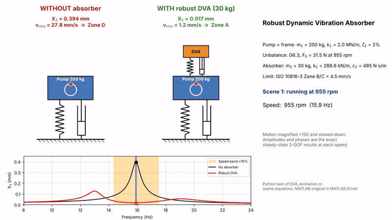
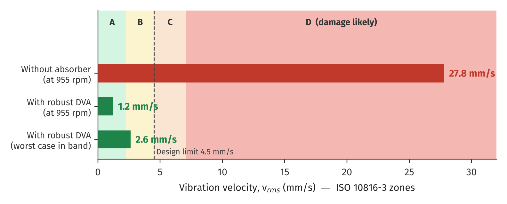
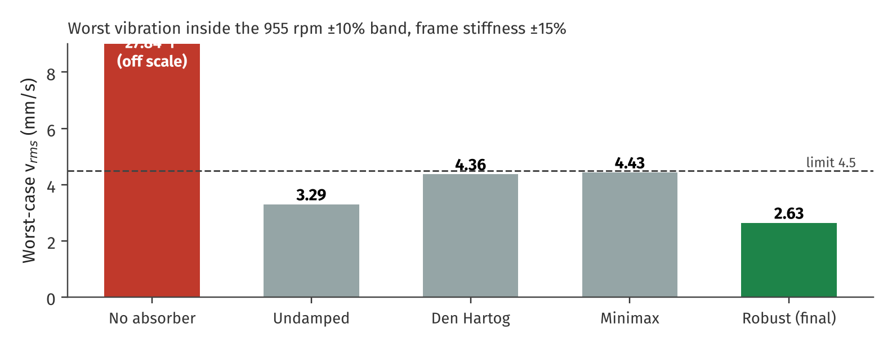
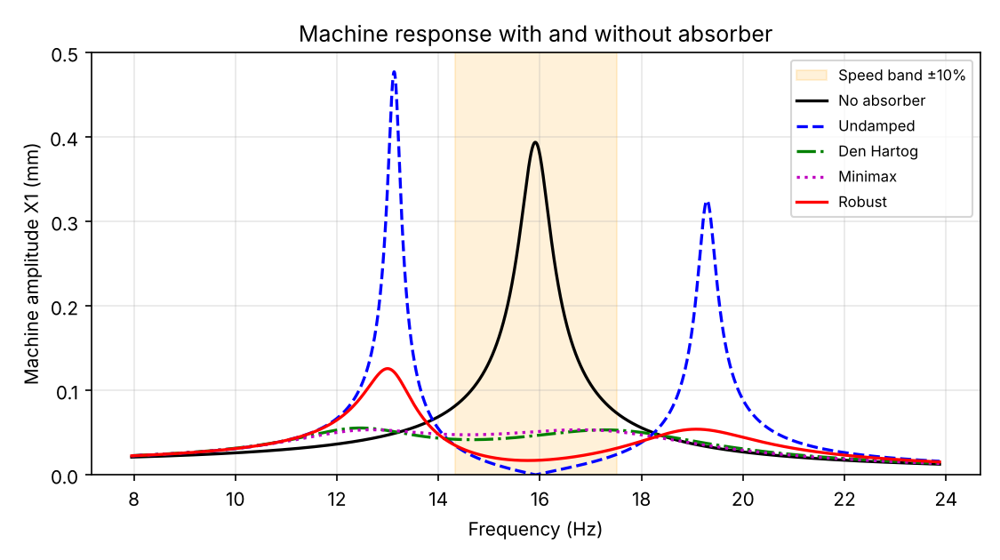
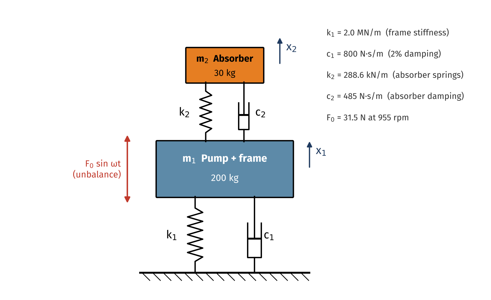
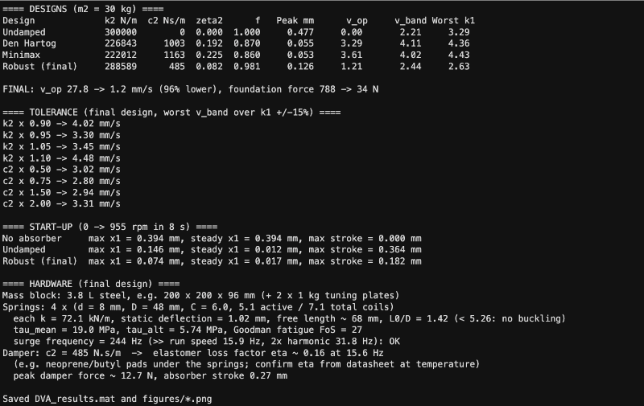
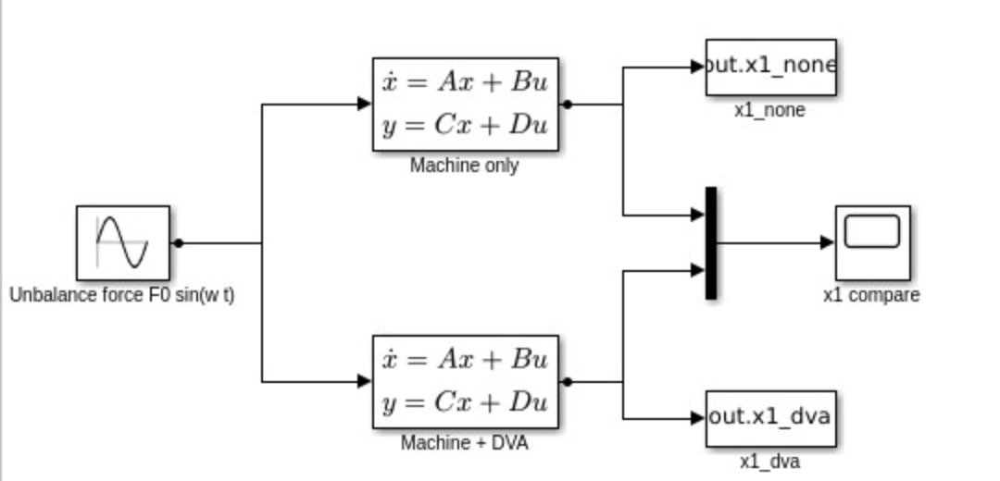
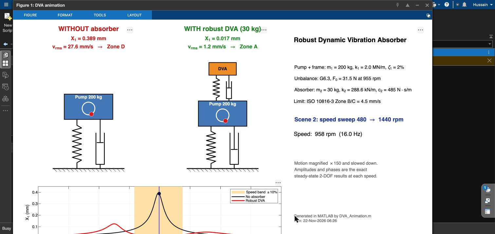

# Robust Dynamic Vibration Absorber for a Pump Running at Resonance

**MATLAB · Simulink · Mechanical Vibrations · Robust Optimisation**

A 200 kg pump runs at **955 rpm**, which is exactly the natural frequency of its steel frame. The result is resonance: **27.8 mm/s rms, ISO 10816-3 Zone D (damage likely)**.

This project designs a **30 kg bolt-on dynamic vibration absorber (tuned mass damper)** that brings the pump to **1.2 mm/s (Zone A)**. It stays below the 4.5 mm/s limit across the full ±10 % speed band, even when the frame stiffness is ±15 % off the model.



*Left: without absorber. Right: with the robust absorber. Motion is magnified ×150 and slowed down. Amplitudes, phases and ISO zones are the exact steady-state 2-DOF results.*

📄 **Full 32-page report (PDF):** [`docs/DVA_Project_Report.pdf`](docs/DVA_Project_Report.pdf)

---

## Results at a glance

| | Without absorber | With robust absorber |
|---|---|---|
| Vibration at 955 rpm | 27.8 mm/s (**Zone D**) | **1.2 mm/s (Zone A)** |
| Worst case in 955 rpm ±10 %, frame stiffness ±15 % | 27.8 mm/s | **2.63 mm/s** (limit 4.5 mm/s, 42 % margin) |
| Force into foundation | 788 N | **34 N** (−96 %) |
| Pump movement during an 8 s start-up | 0.394 mm | 0.074 mm |



## What makes this more than a textbook exercise

1. **Realistic inputs.** The unbalance force (31.5 N) is derived from the ISO 21940-11 balance grade G6.3, not guessed. An early draft used 200 N; that gave physically impossible results and was corrected.
2. **A pass/fail criterion from a standard.** The design must meet ISO 10816-3 Zone B (≤ 4.5 mm/s) across the operating band.
3. **A documented design iteration.** A 20 kg absorber (μ = 0.10) **fails** the check at 4.73 mm/s, so the absorber mass was increased to 30 kg.
4. **Four designs compared:** undamped (classic), Den Hartog closed form, numerical minimax, and a **robust optimum**. The robust optimum minimises the worst vibration over 13 frame-stiffness cases.
5. **Start-up checked in the time domain** with `ode45`. The unbalance force grows with speed² as the pump starts.
6. **Buildable hardware.** The design uses 4 helical springs (d = 8 mm, D = 48 mm). Static, buckling, fatigue (Goodman/Zimmerli) and surge checks are done. Damping comes from elastomer pads with η ≈ 0.16, and 1 kg tuning plates allow on-site tuning.
7. **Tolerance study.** A ±10 % error in spring stiffness uses up almost all of the margin, which is why on-site tuning is required.
8. **Verified three ways:** frequency-domain MATLAB, a Simulink model built by code (identical result, 0.394 mm → 0.017 mm), and an animation.




## The model



| Design (m₂ = 30 kg) | k₂ (N/m) | c₂ (N·s/m) | ζ₂ | v at 955 rpm (mm/s) | Worst in band, k₁ ±15 % (mm/s) |
|---|---|---|---|---|---|
| Undamped | 300,000 | 0 | 0 | 0.00 | 3.29 |
| Den Hartog | 226,843 | 1,003 | 0.192 | 3.29 | 4.36 |
| Minimax | 222,012 | 1,163 | 0.225 | 3.61 | 4.43 |
| **Robust (final)** | **288,589** | **485** | **0.082** | **1.21** | **2.63** |

## Repository structure

```
matlab/
  DVA_Main.m            all analysis: baseline, mass ratio, 4 designs, robustness, start-up, hardware sizing
  DVA_Simulink_Build.m  builds DVA_Simulink.slx in code, runs it, compares with DVA_Main.m
  DVA_Animation.m       side-by-side animation -> video, GIF, key frames
  DVA_Experiment.m      table-top validation rig sizing + phone-accelerometer FFT processing
figures/                result figures and diagrams
animation/              animation GIF/MP4 + screenshots of MATLAB Online running it
docs/                   full PDF report + MATLAB Online / Simulink screenshots
python/                 independent cross-check of every number, and the GIF renderer
```

## How to run

```matlab
cd matlab
DVA_Main            % prints all results, saves figures/ and DVA_results.mat
DVA_Simulink_Build  % needs Simulink
DVA_Animation       % about 3 minutes in MATLAB Online
DVA_Experiment      % uses a demo signal until you add phyphox CSV files
```

Only base MATLAB is needed (`fminsearch`, `ode45`). Simulink is needed only for `DVA_Simulink_Build.m`. All scripts were run in **MATLAB Online and Simulink on 22 Nov 2026**; see [`docs/screenshots`](docs/screenshots).

## Verification

| MATLAB Online output | Simulink model |
|---|---|
|  |  |



The GIF/MP4 in this repository were rendered from the same equations by `python/render_animation.py`, at a smaller file size for GitHub. MATLAB's own output (`DVA_animation.avi`, 320 frames) is produced by running `DVA_Animation.m`.

## Honest scope and limitations

- This is a **representative design case study**. The pump and frame values are realistic and justified, but they do not come from a specific plant.
- The frame is modelled as one vertical degree of freedom. Rocking and horizontal modes, temperature effects on the elastomer, and 2× / vane-pass excitation are listed in the report as next steps.
- A **table-top experiment** (aluminium bar + phone accelerometer + steel-strip absorber) is fully specified and scripted. **No measured data has been reported yet.**

## References

Den Hartog, *Mechanical Vibrations* · Rao, *Mechanical Vibrations* · Budynas & Nisbett, *Shigley's Mechanical Engineering Design* · ISO 10816-3 / 20816-3 · ISO 21940-11

---

**Author:** Hameed Hussain · Licence: MIT
